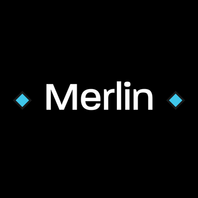

  

# Merlin - Native Player Buffs & Debuffs for WoW Forever

**Merlin** is a lightweight, standalone replacement for Blizzard's player buffs, debuffs, external defensives, and weapon enchantments, built natively on Forever's `CustomAuraContainerTemplate` and `CustomAuraButton` architecture.

Because aura icons, durations, stack counts, cooldown swipes, dispel borders, tooltips, and in-combat right-click buff cancellation are driven directly by the Forever client, Merlin stays responsive, predictable, and combat-safe across encounters and PvP without ever reading restricted aura data.

## Core Features

### Four Dedicated Aura Groups

- **Buffs** — Replaces Blizzard's default `BuffFrame` with customizable sizing, wrapping, sorting, growth directions, and optional attached weapon enchantments (placed before or after buffs).
- **Debuffs** — Replaces Blizzard's `DebuffFrame` aura display while leaving `DeadlyDebuffFrame` intact. Supports live dispel-type border coloring (*Physical/None, Magic, Curse, Disease, Poison, Bleed*) and an optional native dispel-type corner badge.
- **Externals** — Dedicated movable bar for external defensive buffs (`ExternalDefensivesFrame` replacement).
- **Weapon Enchants** — Tracks Main Hand, Off Hand, and Ranged temporary weapon enchantments (poisons, stones, oils, imbues, spellstones, firestones). Keep them attached to Buffs, detach them into a single grouped bar, or split them into three independent movable slots — with optional enchant-specific icons instead of weapon textures.

### Layout, Timers & Visual Polish

- **Flexible Layout:** Horizontal or vertical orientation, X/Y growth directions, icons per row, max icon limits, and X/Y spacing.
- **Native Sorting:** Sort by Default, Duration, Name, or Index (Normal or Reverse).
- **Flexible Anchoring:** Anchor any group to the **Screen**, **Minimap**, or **Buffs**, drag movers interactively with `/merlin unlock`, or fine-tune exact X/Y offsets.
- **Duration Formatting:** Six timer styles (`Smart`, `Compact`, `Detailed`, `Clock`, `Decimal`, `Blizzard`), sub-10s tenths (`Decimals`), three rounding modes (`Nearest`, `Ceiling 90m`, `Round up`), and custom **Warn** / **Urgent** colors and thresholds.
- **Typography & Frames:** SharedMedia font support, outline modes, custom timer and stack text anchors/offsets, optional normal or reverse cooldown swipes, `0–3 px` pixel-snapped borders, icon zoom, and **Out-of-Combat Alpha** fading.
- **Optional Masque Support:** Separate Masque skinning groups for **Buffs**, **Debuffs**, **External Defensives**, and **Weapon Enchants**.

### Profiles, Presets & Sharing

- **Live Preview Strip:** Every group tab previews sample icons, durations, stacks, borders, swipes, and dispel badges as you configure it.
- **Per-Group Profile Overrides:** Assign any group independently to **Default**, **Role** (`Tank` / `Healer` / `DPS`), or **Class**. Switching back to **Default** preserves your Role and Class overrides so you can switch back anytime without losing customization.
- **Import & Export:** Share full profiles, defaults, role overrides, or class overrides via compact `!MERLIN1!` strings.

## Installation

**Addon manager:** Install Merlin from [CurseForge](https://www.curseforge.com/wow/addons) using the CurseForge app or any compatible addon manager.

**Manual:**

1. Download the latest `Merlin-vX.Y.Z.zip` from the [Releases](../../releases) page.
2. Extract the `Merlin` folder into `World of Warcraft/_forever_/Interface/AddOns/`.
3. Restart the game or run `/reload`.

## Slash Commands

| Command | Action |
| --- | --- |
| `/merlin` | Open or close the configuration panel (also `/merlin config`, `/merlin options`). |
| `/merlin unlock` | Unlock draggable aura movers (also `/merlin move`). |
| `/merlin lock` | Lock aura movers. |
| `/merlin reset` | Reset all group positions to defaults. |

> **Note:** Moving frames and opening settings are restricted during combat, boss encounters, and PvP matches; changes refresh automatically once restrictions clear.

## Requirements & Optional Addons

- **Game Version:** World of Warcraft **Forever 1.60.1+** (`Interface: 16001`)
- **Optional:**
  - **Masque** — custom button skins (toggle under **Settings → Appearance → Use Masque**; requires `/reload`).
  - **LibSharedMedia-3.0** — additional fonts for duration and stack text.

## License

Merlin is released under the [MIT License](LICENSE).
